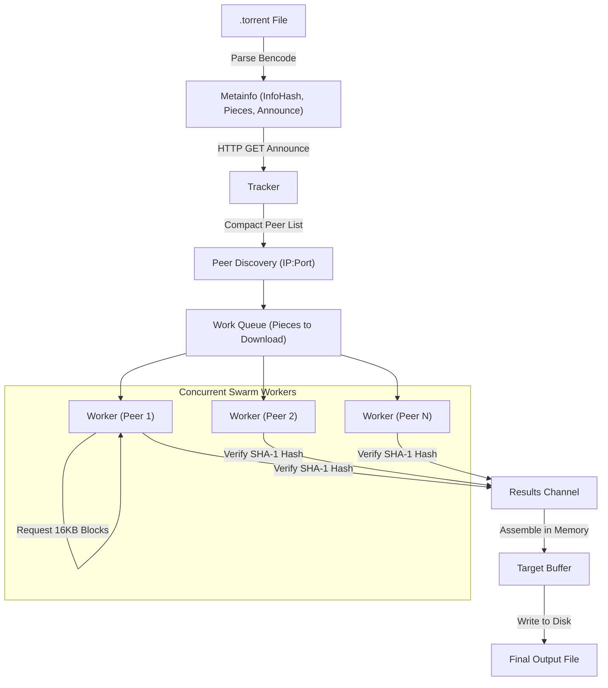

# Torrentis

<p align="center">
  <strong>A lightweight, concurrent BitTorrent client built from scratch in Go.</strong>
</p>

<p align="center">
  
  
  
</p>

---

## 📖 Overview

**Torrentis** is an educational, fully-functional BitTorrent client written from the ground up in Go. It implements the core BitTorrent specification ([BEP 0003](https://www.bittorrent.org/beps/bep_0003.html)), capable of parsing `.torrent` metainfo files, announcing to HTTP trackers, performing TCP peer handshakes, coordinating concurrent peer downloads via worker pools, and assembling verified files on disk.

---

## ✨ Features

- **Bencode Parsing**: Decodes `.torrent` metainfo files and tracker responses using bencode deserialization.
- **HTTP Tracker Communication**: Announces client presence to trackers using compact peer representation (`compact=1`) and calculates SHA-1 `info_hash` parameters.
- **TCP Peer Wire Protocol**: Implements full peer connection lifecycle including standard 68-byte handshake, bitfield exchange, and message framing.
- **Concurrent Worker Pool**: Spawns dedicated goroutines per peer to download distinct pieces simultaneously across the swarm.
- **Pipelined Block Requests**: Employs a request backlog (pipelining up to 5 concurrent 16 KB block requests per peer) to maximize network throughput and eliminate latency bottlenecks.
- **SHA-1 Integrity Verification**: Validates downloaded piece buffers against the cryptographic 20-byte SHA-1 piece hashes specified in the torrent metainfo.
- **Resilient Work Distribution**: Work queue architecture automatically returns unfulfilled or corrupted pieces back to the queue if a peer disconnects or fails verification.
- **Real-Time Progress Tracking**: Terminal output displays completed piece count, current percentage, and active peer worker count.

---

## 🏗️ Architecture & Flow



---

## 📁 Project Structure

```text
torrentis/
├── bitfield/
│   └── bitfield.go       # Bitfield manipulation (HasPiece, SetPiece)
├── client/
│   └── client.go         # Peer TCP connection, handshake, and message dispatch
├── handshake/
│   └── handshake.go      # BitTorrent handshake serialization and parsing
├── message/
│   └── message.go        # Protocol message serialization (Choke, Unchoke, Request, Piece, etc.)
├── p2p/
│   └── p2p.go            # Swarm orchestrator, worker pool, pipelining, integrity check
├── peers/
│   └── peers.go          # Peer struct & compact IP:Port binary unmarshaling
├── torrentfile/
│   ├── torrentfile.go    # .torrent parser and file writer
│   └── tracker.go        # HTTP tracker URL builder and response parser
├── go.mod
├── go.sum
├── main.go               # CLI entrypoint and argument parser
└── README.md
```

### Module Breakdown

| Package | Purpose |
| :--- | :--- |
| **`main`** | Parses CLI arguments (`<torrent-file>`, `<output-file>`) and initiates the download. |
| **`torrentfile`** | Unmarshals `.torrent` bencode files, computes the 20-byte `info_hash`, and requests peers from HTTP trackers. |
| **`peers`** | Parses compact 6-byte peer representations (4 bytes IPv4 + 2 bytes Big-Endian port). |
| **`handshake`** | Encodes and decodes the standard 68-byte BitTorrent handshake (`<pstrlen><pstr><reserved><info_hash><peer_id>`). |
| **`bitfield`** | Manages peer piece availability through a compact byte-level bitfield. |
| **`message`** | Handles serialization and deserialization of peer-wire messages (Keep-Alive, Choke, Unchoke, Interested, Have, Bitfield, Request, Piece). |
| **`client`** | Manages TCP connections with individual peers, state tracking (`Choked`), and high-level message sending. |
| **`p2p`** | Coordinates the concurrent download manager, work channels, worker goroutines, block pipelining, and buffer reassembly. |

---

## ⚙️ How It Works Under the Hood

### 1. Metainfo & Bencode Parsing
A `.torrent` file is encoded in **Bencode** (integers, strings, lists, dictionaries). Torrentis decodes the dictionary to extract:
- **`announce`**: The HTTP tracker URL.
- **`info` dictionary**: File length, piece length, file name, and concatenated 20-byte SHA-1 piece hashes.
- **`info_hash`**: The 20-byte SHA-1 hash of the bencoded `info` dictionary itself, serving as the universal identifier for the torrent.

### 2. Tracker Communication
Torrentis queries the tracker via HTTP GET with URL query parameters:
```text
GET /announce?compact=1&info_hash=<20-bytes>&peer_id=<20-bytes>&port=6881&uploaded=0&downloaded=0&left=<length>
```
The tracker responds with a compact byte array where every 6 bytes represent one peer (`4 bytes IP` + `2 bytes Port`).

### 3. Peer Handshake & State Exchange
Upon dialing a peer over TCP:
1. Both ends exchange a **Handshake** containing the protocol string (`BitTorrent protocol`), 8 reserved bytes, the `info_hash`, and a randomly generated `peer_id`.
2. The peer sends its **Bitfield**, detailing which pieces it owns.
3. Torrentis sends an **Unchoke** and **Interested** message to signal readiness to download.

### 4. Pipelined Piece Downloading
Each piece is split into smaller **16 KB blocks** (`MaxBlockSize = 16384`). 
- Instead of waiting for each block before requesting the next (which suffers from round-trip latency), Torrentis maintains a **pipeline backlog** of up to 5 in-flight block requests (`MaxBacklog = 5`).
- Once all blocks for a piece are downloaded, the client computes `sha1(buf)` and verifies it against the torrent's expected piece hash.
- Verified pieces are copied into their exact offset in the output buffer, and the worker notifies the peer with a `Have` message.

---

## 🚀 Getting Started

### Prerequisites

- [Go](https://go.dev/dl/) **1.21** or later installed.
- Internet connection (access to tracker and peer swarm).

### Installation

Clone the repository and build the binary:

```bash
# Clone the repository
git clone https://github.com/nishankx/torrentis.git

# Navigate into the project folder
cd torrentis

# Build the executable
go build -o torrentis.exe .

# (Optional) Install globally into your $GOPATH/bin
go install
```

---

## 💻 Usage

Run the `torrentis` binary by providing the path to a `.torrent` file and the desired destination file:

```bash
torrentis <path-to-torrent-file> <output-file>
```

### Examples

#### Windows (PowerShell)
```powershell
# Using relative or absolute path to the .torrent file
torrentis debian-13.7.0-amd64-netinst.iso.torrent debian.iso

# Or running the local binary directly
.\torrentis.exe torrentfile\test\debian-13.7.0-amd64-netinst.iso.torrent debian.iso
```

#### Linux / macOS
```bash
./torrentis debian-13.7.0-amd64-netinst.iso.torrent debian.iso
```

### Sample Output

```text
2026/10/20 16:50:48 Completed handshake with 194.26.29.112:51413
2026/10/20 16:50:48 Starting download for debian-13.7.0-amd64-netinst.iso
2026/10/20 16:50:49 Completed handshake with 212.129.44.150:6881
2026/10/20 16:50:52 (0.10%) Downloaded piece #0 from 14 peers
2026/10/20 16:50:53 (0.21%) Downloaded piece #1 from 14 peers
2026/10/20 16:50:55 (0.31%) Downloaded piece #2 from 14 peers
...
2026/10/20 17:02:14 (100.00%) Downloaded piece #960 from 18 peers
```

---

## 🔧 Key Parameters & Constants

| Constant | Location | Value | Description |
| :--- | :--- | :--- | :--- |
| `Port` | `torrentfile/torrentfile.go` | `6881` | Default incoming peer port announced to the tracker. |
| `MaxBlockSize` | `p2p/p2p.go` | `16384` (16 KB) | Size of individual block request chunks. |
| `MaxBacklog` | `p2p/p2p.go` | `5` | Maximum number of concurrent in-flight block requests per peer. |
| Tracker Timeout | `torrentfile/tracker.go` | `15s` | Timeout for HTTP tracker responses. |
| Dial Timeout | `client/client.go` | `3s` | Timeout for establishing TCP connection with a peer. |
| Read Deadline | `p2p/p2p.go` | `30s` | Read deadline when receiving piece blocks from a peer. |

---

## 🗺️ Roadmap & Future Enhancements

- [ ] **Direct Disk Streaming**: Stream completed pieces directly to disk to minimize memory consumption on large multi-gigabyte downloads.
- [ ] **Resume & Pause Support**: Check existing file pieces on startup to resume partial downloads without starting from scratch.
- [ ] **Multi-File Torrent Support**: Handle multi-file directory structures specified in the `files` bencode dictionary.
- [ ] **UDP Tracker Protocol ([BEP 15](https://www.bittorrent.org/beps/bep_0015.html))**: Support tracker announces over UDP for trackers that don't support HTTP.
- [ ] **DHT (Distributed Hash Table, [BEP 5](https://www.bittorrent.org/beps/bep_0005.html))**: Trackerless peer discovery via Kademlia DHT.
- [ ] **Seeding Support**: Serve downloaded pieces back to other peers in the swarm.
- [ ] **Magnet Link Resolution ([BEP 9](https://www.bittorrent.org/beps/bep_0009.html))**: Fetch torrent metadata on the fly from magnet URIs.

---

## 📜 License

This project is licensed under the [MIT License](LICENSE).
